# Warehouse Ops Console (WOC)

A control-room and handheld web app for a simulated robotic warehouse: live 3D fleet map (Babylon.js), virtualized fleet table,
orders with task timelines, a coded/localized event stream (EN/JA) and a 360x800 handheld pick/scan view. React + TypeScript on the
front, FastAPI + asyncio simulator + PostgreSQL behind it, deployed to AWS with Terraform for a short session, then destroyed.

> **Status:** the AWS stack was deployed, captured and **destroyed** (see `docs/evidence/destroy-verified.txt`).
> Run it yourself with `make dev-mock` (no backend needed) or `make dev`.

## Architecture

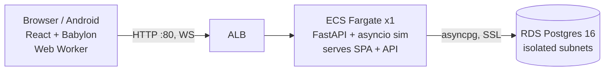

Frontend data flow: `WebSocket -> telemetry.worker -> Float32Array (transferred) -> telemetryStore -> Babylon render loop`;
React reads only throttled (<=2 Hz) or per-row selectors. `VITE_DATA_SOURCE=mock` swaps in an in-browser simulator plus MSW.

## Job-post coverage

| Item | Where |
|---|---|
| Web + industrial Android UIs | control-room routes, `/handheld` PWA (360x800, keyboard-wedge scan input) |
| Reusable high-performance components, real time | virtualized `RobotTable`, `TwinCanvas` (thin instances), `KpiTile`, `EventStream` |
| Backend integration | OpenAPI-generated TS types, TanStack Query, REST + WebSocket, optimistic mutation |
| Profiling / stability | `PerfHud` (FPS, commits/s, msg/s), telemetry kept out of React's render path |
| Testing, localization, release | Vitest, Playwright, `i18n:check`, GitHub Actions, versioned Docker image, `scripts/deploy.sh` |
| Production-issue flow | fault injection -> event stream + toast + red robot; CloudWatch log evidence |
| React, Babylon.js, WebGL, TS/JS | `apps/web` |
| Python, async, threading | FastAPI, asyncio simulator, browser Web Worker |
| Full stack on AWS, Linux | ALB, ECS Fargate, RDS, ECR, Terraform, Docker, Makefile, uv, pnpm |
| Customer-site mindset | connection chip with latency, Live/Mock indicator |
| C++/Python addon | not built (stretch) |

## Screenshots (captured from the live AWS deployment)

| | |
|---|---|
| 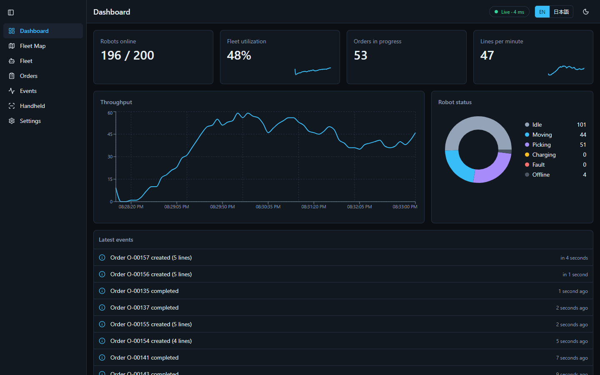 | 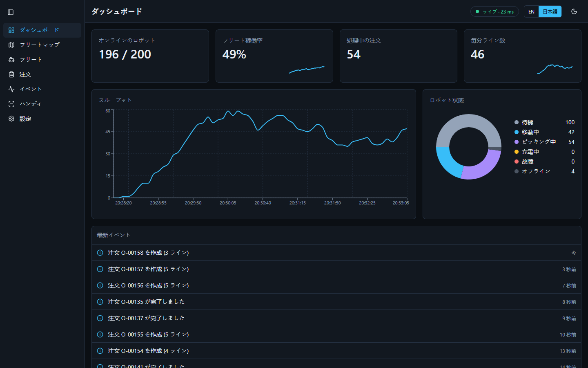 |
| 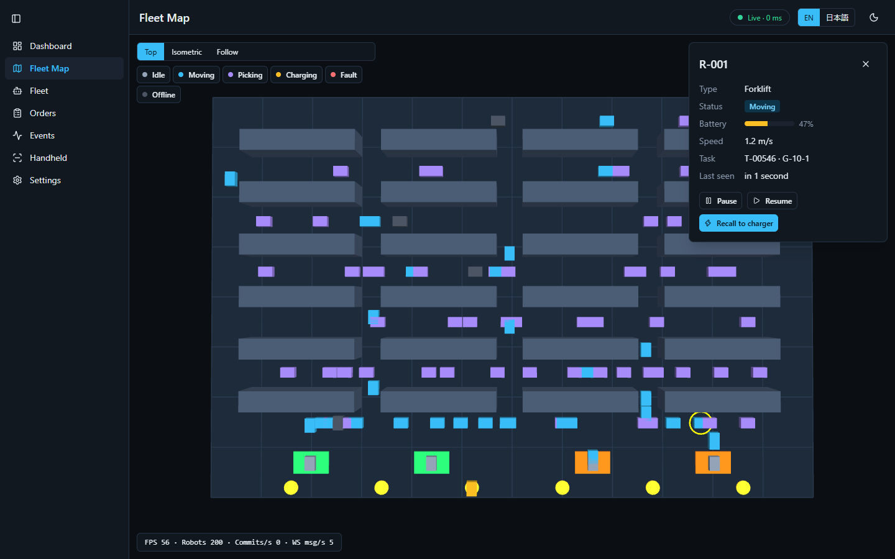 | 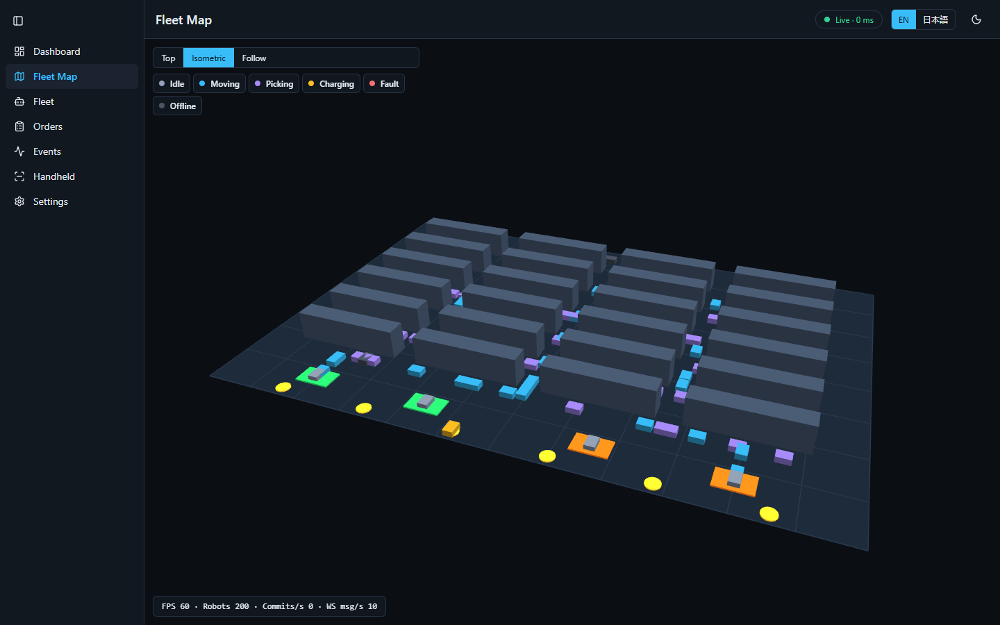 |
| 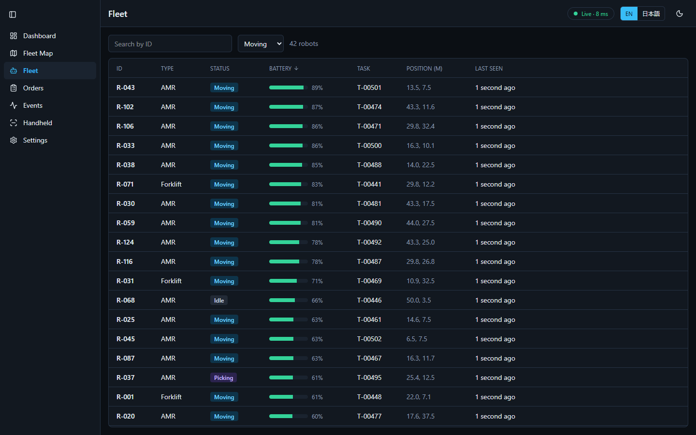 | 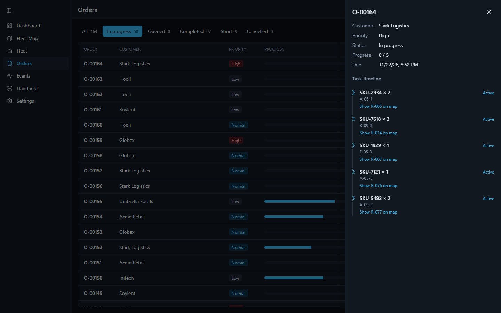 |
| 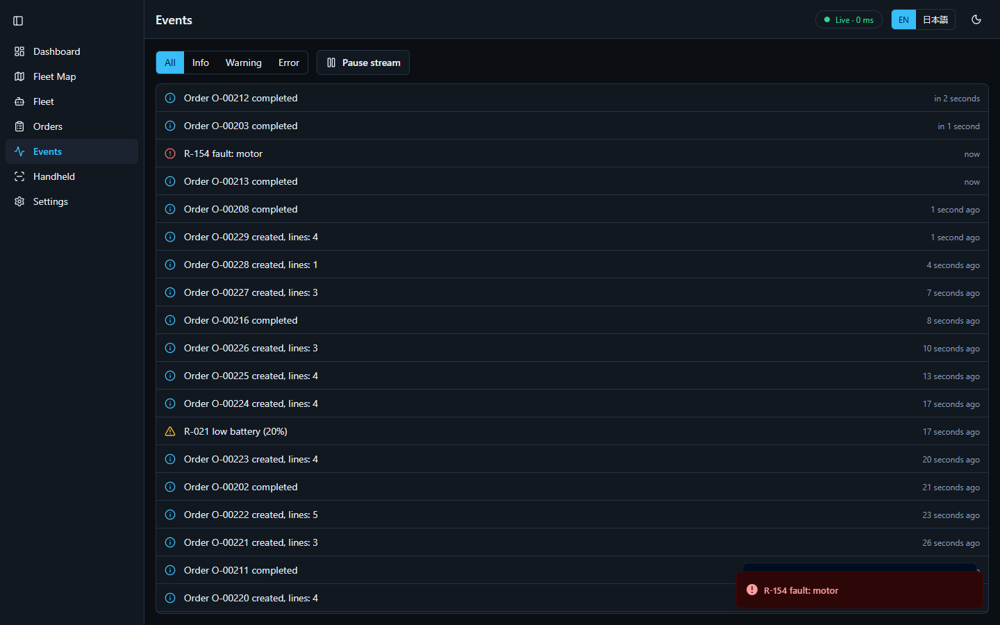 | 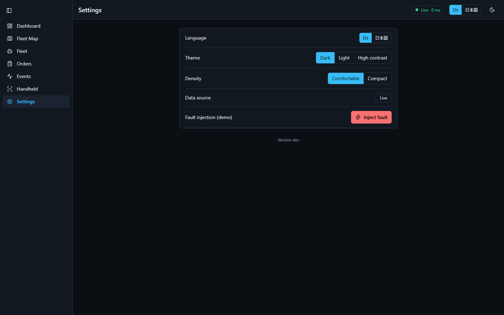 |
| 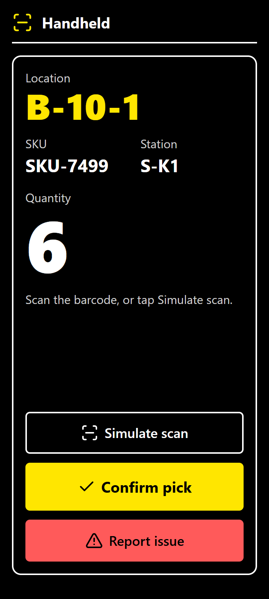 | 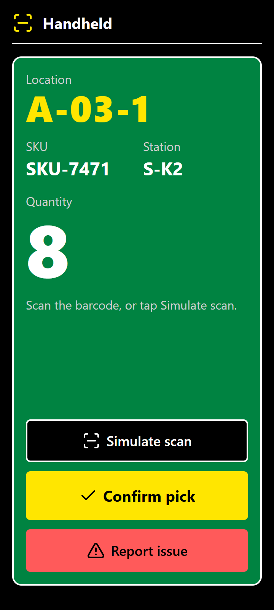 |
| 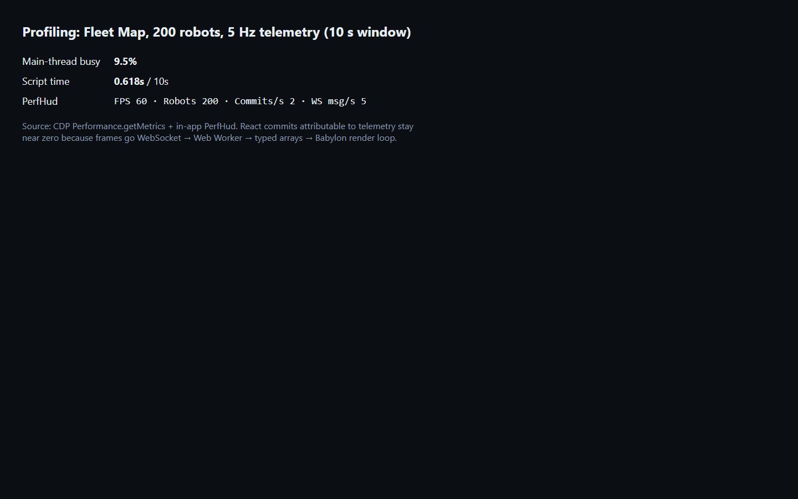 | 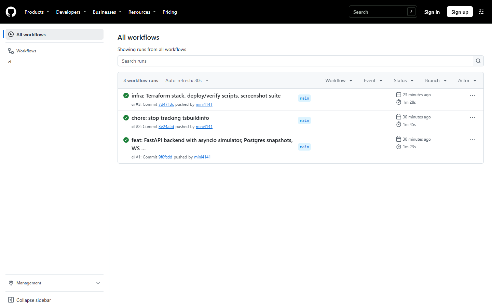 |

Map: 60 FPS with 200 robots, 0-1 React commits/s (GPU-backed Chrome; software WebGL manages ~20 FPS).

## Evidence

AWS-console screenshots are not possible headless, so CLI evidence is saved in `docs/evidence/`: `terraform-apply.txt`,
`terraform-outputs.json`, `ecs-service.json`, `rds-instance.json`, `alb.json`, `cloudwatch-logs.txt` (the fault events),
`perf-metrics.json`, `cost-estimate.md` (about USD 0.05-0.10 for ~0.5 h), `terraform-destroy.txt`, `destroy-verified.txt`.

## Deviations (honest list)

- **No CloudFront:** AWS refused to create the distribution (account needs Support verification). The API image serves the SPA
  and the ALB accepts HTTP from the internet for the session. The CloudFront + S3 path remains in Terraform behind
  `enable_cloudfront` but is untested.
- HTTP only, no auth, DB SSL without certificate verification: demo scope.
- The budget has no email subscriber (pass `-var alert_email=...`).
- `ja` strings are Claude-drafted and need native review. Stretch items (pybind11 addon, Capacitor APK, OIDC deploy,
  Storybook, Cognito, OffscreenCanvas) were not built.

## Run locally

```
make setup
make dev-mock   # frontend only, in-browser simulator
make dev        # docker compose db + api, web against the live API
make check      # lint, typecheck, tests, i18n:check; ruff + pytest
```

## What I would harden next

Auth and roles, input validation, observability (metrics/traces), multi-task scaling with Redis pub/sub,
HTTPS via ACM + CloudFront once the account is verified, load testing.
